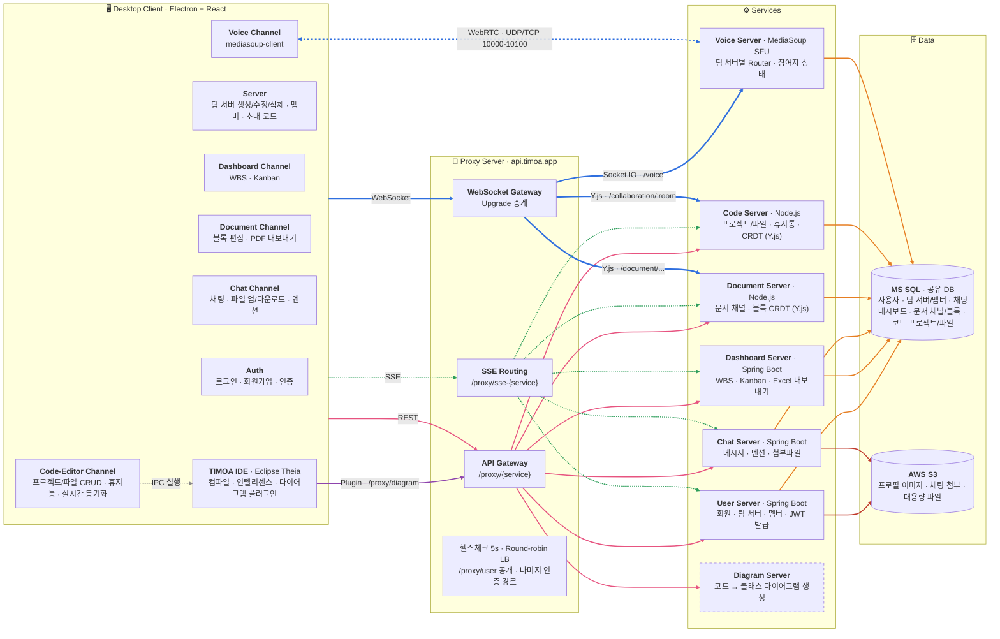

<h1 align="center">TIMOA</h1>

  <b>Team Integrated Management Organization Assistance</b> 
  팀 단위 실시간 협업 플랫폼

  
  
  
  
  
  
  

  <a href="https://www.timoa.app">🌐 www.timoa.app</a>

---

## 프로젝트 소개

TIMOA는 개발 팀을 위한 올인원 협업 환경입니다.  
**Visual Studio Live Share · Discord · Notion · Trello**의 핵심 기능을 하나의 데스크탑 애플리케이션으로 통합하여,  
팀원들이 창 전환 없이 코딩·소통·문서화·프로젝트 관리를 동시에 수행할 수 있습니다.

| 통합 대상 | TIMOA 제공 기능 |
|---|---|
| Visual Studio Live Share | Y.js CRDT 기반 실시간 코드 동시 편집 |
| Discord | 채널 채팅 + MediaSoup SFU 음성 통화 |
| Notion | Notionblock.js 기반 블록 문서 협업 |
| Trello / Jira | WBS · 칸반보드 대시보드 |

---

## 아키텍처

| 선 | 프로토콜 | 사용처 |
|---|---|---|
| 🩷 실선 | **REST** | 모든 CRUD 요청 (`/proxy/{service}`), 파일 업로드 (`/chat-upload`, `/user-upload`) |
| 💚 점선 | **SSE** | 서버 → 클라이언트 변경 알림 (User · Dashboard · Chat · Document · Code) |
| 💙 굵은 선 | **WebSocket** | Y.js CRDT 동기화 (Code · Document), Socket.IO 시그널링 (Voice) |
| 💙 점선 | **WebRTC** | 음성 미디어. Proxy를 거치지 않고 SFU로 직접 전송 |
| 🧡 | **SQL** | 단일 MS SQL 공유 DB ([ADR 0003](https://github.com/TIMOA-MAIN/TIMOA_Docs/blob/main/decisions/architecture/0003-shared-db.md)) |
| ❤️ | **S3** | User(프로필 이미지 · 파일), Chat(첨부파일) |
| 💜 | **Plugin** | TIMOA IDE 플러그인 → Diagram Server (`/proxy/diagram`) |

> Diagram Server는 Proxy에 라우팅(`/diagram`)만 등록되어 있고 이 조직에 레포가 없어 점선 테두리로 표시했습니다.

MSA 지향 구조로 서비스별 독립 기술 스택을 선택했습니다.  
각 기술 결정의 근거는 **[TIMOA_Docs](https://github.com/TIMOA-MAIN/TIMOA_Docs)** 에 ADR 형식으로 기록되어 있습니다.

---

## 주요 기술 결정

| 결정 | 선택 | 핵심 이유 |
|---|---|---|
| 실시간 동시 편집 | Y.js CRDT | 충돌 없는 병합 수학적 보장 |
| 음성 통화 | MediaSoup SFU | 다중 사용자 확장성·방화벽 안정성 |
| 채팅·대시보드 실시간 | REST + SSE | 단방향 푸시에 최적, WebSocket 대비 서버 부하 낮음 |
| Reverse Proxy | Node.js (자체 구현) | 헬스체크 기반 런타임 동적 라우팅 |
| 코드 에디터 | Eclipse Theia | VS Code Extension 생태계 활용, 언어 제약 없음 |
| 파일 스토리지 | AWS S3 | 정형/비정형 데이터 분리, DB 용량 최적화 |

---

## 서비스 구성

| 레포지토리 | 언어 | 역할 |
|---|---|---|
| [Proxy_Server](https://github.com/TIMOA-MAIN/Proxy_Server) | Node.js | 헬스체크·동적 라우팅·WebSocket 중계 |
| [Code_Server](https://github.com/TIMOA-MAIN/Code_Server) | Node.js | Eclipse Theia + Y.js CRDT 코드 편집 |
| [Document_Server](https://github.com/TIMOA-MAIN/Document_Server) | Node.js | Notionblock.js + Y.js CRDT 문서 편집 |
| [Voice_Server](https://github.com/TIMOA-MAIN/Voice_Server) | Node.js | MediaSoup SFU 음성 통화 |
| [Chat_Server](https://github.com/TIMOA-MAIN/Chat_Server) | Java | REST + SSE 채팅, AWS S3 파일 |
| [Dashboard_Server](https://github.com/TIMOA-MAIN/Dashboard_Server) | Java | WBS · 칸반보드, REST + SSE 동기화 |
| [User_Server](https://github.com/TIMOA-MAIN/User_Server) | Java | 사용자 인증·계정 관리 |
| [Desktop_Client](https://github.com/TIMOA-MAIN/Desktop_Client) | TypeScript | Electron 데스크탑 클라이언트 |
| [TIMOA_Docs](https://github.com/TIMOA-MAIN/TIMOA_Docs) | — | 아키텍처 결정 기록 (ADR) |

---

## 기술 스택

<table>
<tr>
  <td><b>클라이언트</b></td>
  <td>Electron · React · TypeScript · Vite</td>
</tr>
<tr>
  <td><b>Node.js 서버</b></td>
  <td>Node.js · Y.js CRDT · MediaSoup · http-proxy-middleware</td>
</tr>
<tr>
  <td><b>Java 서버</b></td>
  <td>Java · Spring Boot · JPA · SSE</td>
</tr>
<tr>
  <td><b>실시간 동기화</b></td>
  <td>Y.js CRDT · WebSocket · SSE</td>
</tr>
<tr>
  <td><b>음성 통화</b></td>
  <td>WebRTC · MediaSoup (SFU) · OPUS 48kHz</td>
</tr>
<tr>
  <td><b>코드 에디터</b></td>
  <td>Eclipse Theia · Monaco Editor · VS Code Extension API</td>
</tr>
<tr>
  <td><b>문서 에디터</b></td>
  <td>Notionblock.js</td>
</tr>
<tr>
  <td><b>DB / 스토리지</b></td>
  <td>MS SQL Server · AWS S3</td>
</tr>
</table>

---

  📄 <a href="https://github.com/TIMOA-MAIN/TIMOA_Docs">아키텍처 문서 (ADR)</a> &nbsp;|&nbsp;
  🌐 <a href="https://www.timoa.app">www.timoa.app</a>

